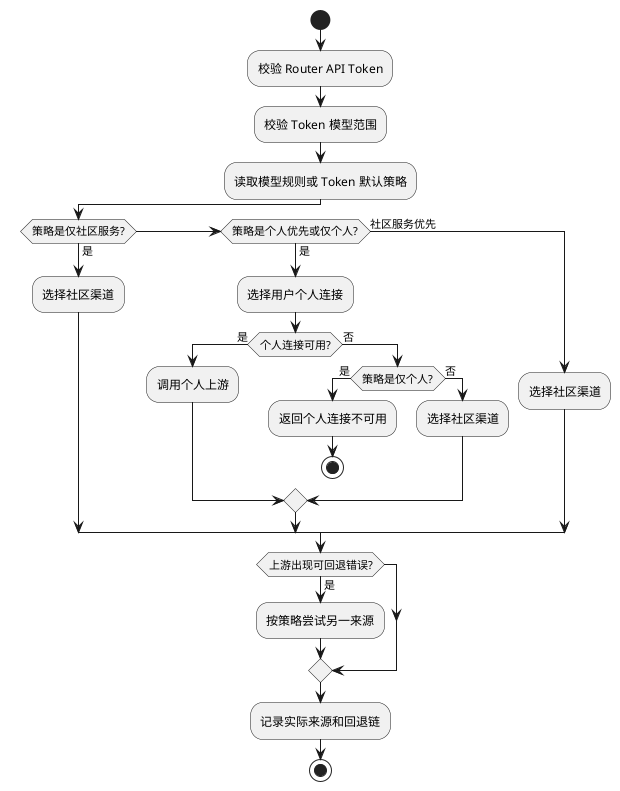

# 自用渠道路由方案

## 目标

Router 给客户端保持一个 Base URL 和一枚 API Token。用户可以在 Router 保存自己的自用渠道；同一请求先按用户策略尝试自用渠道，必要时再使用供给渠道。客户端不需要为不同渠道切换 API Key。

本方案解决的是用户自有凭据的接入和混合选路，不是用户向其他用户出售上游容量。产品渠道顶层只分平台自营和独立运营；“自用”与“供给”是独立运营渠道的用途，不是额外的渠道类型。

## 产品对象

| 对象 | 用户看到的内容 | 运行职责 |
| --- | --- | --- |
| 自用渠道 | 连接、协议、模型范围、优先级、启停、凭据轮换、运行指标和验证结果 | 用户私有上游连接 |
| 我的模型路由 | 某个模型的来源策略 | 在 Token 来源边界内决定优先级或收紧范围 |
| API Token | 模型范围、默认路由策略、请求限额 | 客户端调用凭证 |
| 调用记录 | 实际来源、回退、个人连接名称、社区扣费 | 可追溯性 |
| 渠道运行指标 | 1 小时、24 小时、7 天或 30 天的成功、失败、成功率、平均延迟、调用量和最近调用 | 来自真实调用日志；额度、成本或收益缺少可靠来源时明确显示不可用 |

自用连接属于一个 `user_id`，不进入平台自营 `channels`，也不允许被其他用户选择。

## 路由策略

API Token 保存 `route_policy`。它同时定义调用凭据允许使用的来源边界和默认优先级：

- `personal_only`、`community_only` 是**硬来源边界**。模型规则不得把“仅个人”变成可使用社区，也不得把“仅社区”变成可使用个人凭据。
- `personal_first`、`community_first` 是可调整的来源偏好。模型规则可以把它们改为另一种偏好，也可以收紧为仅个人或仅社区。

这样，API Token 可以安全地交给不同客户端使用；Token 创建者对成本、数据去向和供应商来源的明确限制，不会被账户级模型规则意外放宽。

| 值 | 产品名称 | 选择顺序 |
| --- | --- | --- |
| `personal_first` | 自用渠道优先，供给渠道回退 | 自用连接，失败后供给渠道 |
| `personal_only` | 仅自用渠道 | 只使用自用连接 |
| `community_only` | 仅供给渠道 | 只使用供给渠道 |
| `community_first` | 供给渠道优先 | 供给渠道，全部失败后自用连接 |

默认值是 `personal_first`。没有匹配自用连接时，默认策略继续尝试供给渠道；`personal_only` 会明确返回没有可用自用连接，绝不扣供给额度。页面文案使用“自用渠道优先，供给渠道回退”，不把回退描述为无条件成功或免费服务：供给渠道调用仍须满足模型、端点、渠道健康度和套餐/余额条件，并按套餐或余额结算。

## 安全边界

1. 密钥仅在创建或轮换请求中接收，任何读取接口只返回 `credential_configured`。
2. 凭据使用 Router 已有必填 `auth.jwt_secret` 派生独立 AES-GCM 密钥加密保存；JWT 回退密钥可用于解密并完成平滑轮换。
3. 请求时才解密；日志、接口响应、错误信息都不输出 API Key。
4. 个人连接只对所属用户的 API Token 生效，管理员的全局指定渠道语义不适用于普通用户。服务端只接受 `openai`、`anthropic`、`gemini`、`ali`、`deepseek` 五种个人文本协议，不能依赖前端下拉框阻止未知协议。
5. 连接删除后不能再被新的请求选中；已有 Responses 会话的后续调用会得到会话上游不可用，而不会切到另一账户。
6. 用户填写的 Base URL 只能是 HTTPS 公有地址，不允许用户信息、查询参数、片段、回环、内网、链路本地、CGNAT 或保留地址。实际转发使用独立 HTTP 客户端，再次解析并直连已校验的公有 IP，且不跟随重定向；它不继承 `RELAY_PROXY`，防止代理端二次解析绕过地址校验。

## 连接验证和健康状态

自用渠道保存后为“未验证”。用户可主动执行“测试连接”，Router 使用与实际自用上游相同的受限 HTTP 客户端，按协议请求模型目录并验证地址可达性和 API Key 权限：

- 探测只访问模型目录，不发送推理请求，不消耗模型 Token；供应商若对其管理接口另行收费，仍以供应商规则为准。
- 连接记录保存最近一次验证时间、成功状态和经过截断的安全错误摘要；不保存或返回 API Key 明文。
- 修改协议、Base URL 或 API Key 会使旧验证结果失效；修改名称、优先级和启停状态不会。
- 验证通过说明该地址和凭据可访问模型目录，不承诺用户填写的每个模型都可用，也不替代真实调用期间的上游健康检查。
- 连接验证和模型测试是渠道验证记录，不创建用户任务，也不写入后台异步任务队列；任务只用于图片、音频、视频等需要后续查询结果的用户异步业务调用。

验证状态和运行健康必须分开展示。验证回答“配置和声明能力是否经过检查”，运行健康回答“所选时间范围内真实请求是否成功、延迟如何、是否发生熔断”。没有真实流量时不能用测试通过率冒充运行成功率。

## 端点和会话边界

第一批只支持文本类兼容端点：`/completions`、`/chat/completions`、`/messages`、`/responses`、`/embeddings`、`/moderations`。

图像、音频、实时连接、视频、文件和异步任务继续使用社区渠道。原因不是协议转换困难，而是这些请求的任务资源和后续查询必须属于同一个上游账户，不能在失败时跨用户凭据转移。

Responses 的 `previous_response_id` 或工具项 ID 已绑定上游时，Router 固定使用原个人连接或原社区渠道；不会因限流、余额不足或策略变更迁移会话。

## 计费和记录

个人来源不扣用户社区余额、YYC 套餐额度或 Token 金额额度；Token 的请求次数限制仍然生效。Token 金额额度在 Router 已选定社区渠道后才校验，因此余额为零的 Token 仍可调用匹配的个人连接，但不能调用社区渠道。调用记录写入：

- `upstream_source`: `personal_provider` 或 `community_package`
- `personal_provider_id`、`personal_provider_name`
- 既有 `route_decision`、`fallback_count`、`fallback_attempts`

用户自己的调用详情展示安全路由摘要：生效来源策略、初始来源、实际来源、个人渠道名称和回退次数。社区渠道 ID、候选渠道、内部端点和上游原始错误属于运营拓扑，只对管理员保留。

个人来源的成功记录将显示“未扣社区套餐”，请求金额和 Router 侧采购成本均为零。个人 API Key 的实际账单只由用户的上游供应商结算；在用户主动提供可验证账单数据前，Router 不推测或展示参考成本。

“我的渠道”按所选时间范围从 `event_logs` 汇总成功、失败、成功率、平均延迟、调用量、最近调用、Token 和可用额度消耗。客户端主动中止不计为上游失败，也不进入延迟与最近有效调用口径。`included_requests = 0` 且 `unlimited = true` 仍表示尚未启用个人来源套餐额度闸门；后续若启用套餐权益，应作为套餐字段加入现有 `request_quota` 权益模型，不另建用户余额，也不在个人连接中写死费用。

个人渠道参考成本和平台服务费的字段、报价和结算必须在真实收费启用时一起落库；当前不得把推测成本记为用户应付费用。

## OpenRouter 参考

OpenRouter 的 BYOK 采用加密、只写入的用户密钥，并提供用户密钥和共享容量的优先或回退选择。Router 采用相同的产品分层，但不复制其具体费率：

- OpenRouter BYOK: https://openrouter.ai/docs/guides/overview/auth/byok
- OpenRouter 上游选择: https://openrouter.ai/docs/guides/routing/provider-selection

## 公开供给边界

供给渠道与模型报价见 [../开放供给/开放模型服务网关方案.md](../开放供给/开放模型服务网关方案.md)。

公开供给不是自用渠道的一个开关。原连接始终是连接所有者独立运营的自用渠道，不会直接进入公共候选池或复用其 API Key。

用户可以从自用渠道发起“申请参与供给”，但 Router 只把名称、协议、Base URL 和模型等非敏感元数据带入一个独立的 `PublisherService` 草稿。它是新的独立运营供给渠道，使用 `publisher-service:<service-id>` 作为稳定产品身份。用户必须重新录入供给凭据，并继续完成发布者准入、连接验证、报价和运营审核。审核通过后，只有运营人员可以通过独立的 `group_supply_bindings` 把报价加入分组；报价以内部 `community-offer:<offer-id>` 句柄参与路由和结算，不会复制成 `channels` 或 `group_channels` 记录，也不会成为第三种产品渠道。
